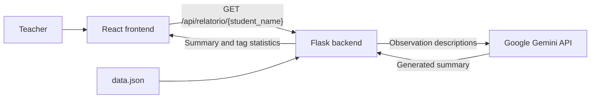

# Dailee — AI Assistant for Special Education Teachers

Dailee is an educational AI prototype that helps teachers working in **Atendimento Educacional Especializado (AEE)**, Brazil’s specialized educational support service, review student observations and generate progress report drafts.

The application combines a **React dashboard**, a **Flask backend**, and the **Google Gemini API**. It uses fictional student records for demonstration and testing.

## Features

- **AI-generated summaries:** Generate a professional, empathetic paragraph about a student’s progress and challenges from recorded observations.
- **Tag frequency dashboard:** Display the relative frequency of behavior tags using horizontal bars.
- **Student selection:** Switch between three predefined demonstration students.
- **Loading and error feedback:** Show the status of report requests in the interface.

The interface is currently in Brazilian Portuguese.

## Architecture



For each report request, the backend:

1. Reads `data.json` and finds the selected student.
2. Calculates tag percentages from the student’s observations.
3. Sends the observation descriptions to Gemini.
4. Returns the summary and statistics to the frontend.

## Technology Stack

| Layer | Technologies |
|---|---|
| Frontend | React, Vite, Tailwind CSS |
| Backend | Python, Flask, Flask-CORS |
| AI integration | Google Gen AI SDK, Google Gemini API |
| Configured model | `gemini-2.5-flash` |
| Data storage | Local JSON file |
| Environment configuration | python-dotenv |

## Repository Structure

```text
botDailee/
├── bot_aee.py                  # Flask API, tag statistics, and Gemini integration
├── data.json                   # Fictional student observations
├── .gitignore
├── README.md
└── projeto-aee/                # React frontend
    ├── package.json
    ├── package-lock.json
    ├── vite.config.js
    ├── postcss.config.js
    ├── public/
    └── src/
        ├── main.jsx
        ├── DashboardAEE.jsx
        └── index.css
```

## Run Locally

### Prerequisites

- Python with support for the required packages
- A Node.js version compatible with the Vite version in `projeto-aee/package.json`
- npm
- A Google Gemini API key with access to the configured model
- Internet access for text generation

### 1. Clone the repository

```bash
git clone https://github.com/ArtemisMenezes/botDailee.git
cd botDailee
```

### 2. Set up the backend

Run these commands from the repository root.

**Windows — PowerShell:**

```powershell
python -m venv .venv
.\.venv\Scripts\python.exe -m pip install flask flask-cors google-genai python-dotenv
```

**macOS / Linux:**

```bash
python3 -m venv .venv
.venv/bin/python -m pip install flask flask-cors google-genai python-dotenv
```

Create a `.env` file in the repository root:

```dotenv
API_KEY=your_gemini_api_key_here
```

Replace the placeholder with your own key locally. Never commit the `.env` file or API credentials.

Start the backend:

**Windows:**

```powershell
.\.venv\Scripts\python.exe bot_aee.py
```

**macOS / Linux:**

```bash
.venv/bin/python bot_aee.py
```

The backend runs at `http://localhost:5000`.

Keep the working directory at the repository root: the backend reads `data.json` using a relative path.

### 3. Start the frontend

Open a second terminal at the repository root:

```bash
cd projeto-aee
npm ci
npm run dev
```

Open the local URL printed by Vite.

The frontend currently sends requests to `http://localhost:5000`. Keep the backend running while using the dashboard.

### Setup Verification

These instructions were derived from the source files. A clean-environment installation and end-to-end run have not yet been verified as part of this documentation review.

## Data and Metrics

Student records are stored under the `alunos` key in `data.json`. Each record contains a name and observations with:

- `etiquetas`: tags associated with an observation.
- `descricao`: a written description of the observation.

The dashboard calculates:

```text
Tag percentage = occurrences of a tag / total tag occurrences × 100
```

For example, if five tags were recorded across several observations and two were “lack of attention,” that tag represents **40% of all recorded tags**.

This does not mean the behavior occurred on 40% of days or in 40% of observations. An observation can contain multiple tags, and displayed values are rounded.

## API

### Generate a student report

```http
GET /api/relatorio/<nome_aluno>
```

Successful responses contain:

| Field | Description |
|---|---|
| `nome` | Student name |
| `estatisticas` | Tag percentages |
| `resumo` | AI-generated summary |
| `total_anotacoes` | Number of observations |

The API returns `404` when the student is not found and `500` when processing fails.

Each successful report request generates a new Gemini response; summaries are not cached.

## Technical Decisions

- **Separate frontend and backend:** React handles presentation, while Flask handles data processing and the AI integration.
- **Structured tags and descriptive notes:** Tags support deterministic statistics; descriptions provide context for text generation.
- **Local JSON storage:** Keeps the prototype’s demonstration data simple.
- **External language model:** Gemini generates narrative summaries without a custom training or fine-tuning pipeline.
- **Backend API configuration:** The Gemini key is loaded by the Python backend rather than included in frontend code.

## Current Status

Report generation and the dashboard have been tested by the author using fictional records.

The prototype demonstrates an end-to-end workflow from stored observations to tag statistics and an AI-generated summary. No formal evaluation of report quality, latency, or educational outcomes has been conducted.

## Limitations

- The prompt requests a monthly summary, but records have no date-based filtering. All available observations for the selected student are included.
- The student selector contains three hardcoded names; it is not populated dynamically from the JSON file.
- Observations must be maintained in `data.json`; the interface does not provide data entry.
- Summaries require teacher review. The interface currently displays text without editing or approval controls.
- Tag frequencies describe the supplied records and do not establish causes or clinical conclusions.
- Generated text may contain inaccuracies or unsupported interpretations.
- Report requests depend on Gemini availability. If generation fails, the current combined endpoint also fails to return dashboard statistics.
- Authentication, access controls, automated tests, and production deployment configuration are not included.
- The Flask server uses debug mode, and CORS is broadly enabled for local prototyping.
- Python dependency versions are not pinned in a requirements file.

## Responsible Use

This repository demonstrates the application with fictional student data.

Student names and observation descriptions are sent to the Gemini API when generating summaries. Use synthetic records for this prototype.

Generated summaries are drafts for professional review. The application is not a diagnostic tool, and testing with fictional records does not establish readiness for handling real student information.

## Planned Development

Integrate the prototype into the application being developed to support AEE teachers in their daily activities.

## Author

Developed by [Ártemis Menezes Castelo](https://github.com/ArtemisMenezes) as part of her studies in LLMs and applied AI for education.
